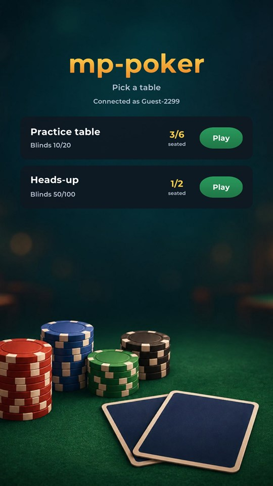
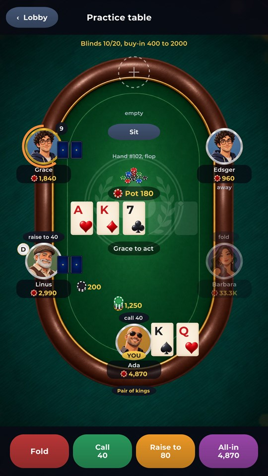
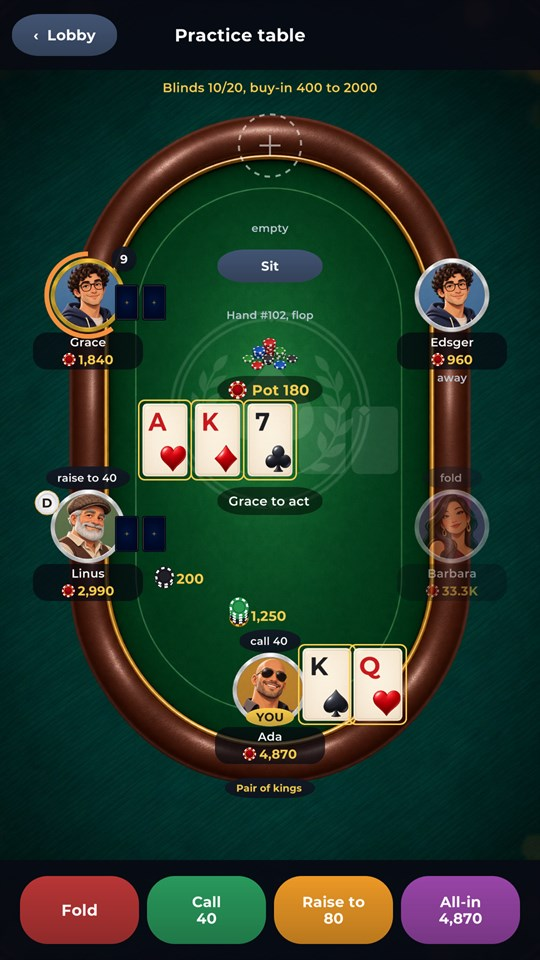
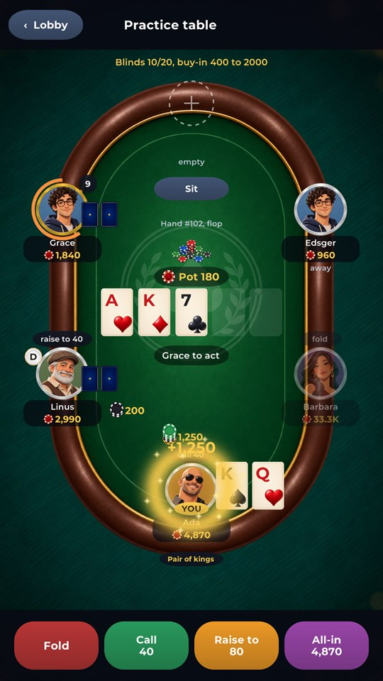

# mp-poker: multiplayer Texas Hold'em in Unity and .NET

A small, readable multiplayer No-Limit Texas Hold'em: a Unity client and an authoritative .NET server, covering every
layer between a tap on "Call" and the chips moving on every screen at the table.

<table>
  <tr>
    <td></td>
    <td></td>
    <td></td>
    <td></td>
  </tr>
</table>

Screenshots are rendered from the real prefabs by the project's own `UiSnapshot` editor tool (`mp-poker > Render UI
Snapshots`, also headless), so they can be refreshed whenever the UI changes.

Play chips only: there is no real money, no payments and no way to cash out. The game is a vehicle for the engineering.

The code is kept small on purpose, and the [design docs](docs/README.md) explain each decision: why the server owns
cards, turns, chips and timers, how a client joins mid-hand and stays in sync, how packets survive a dropped connection,
and how animations stay decoupled from network timing.

## What this demonstrates

- **Server authority and fairness.** The server deals, validates every move and owns every chip. Hole cards are sent
  only to their owner, turn ids make moves idempotent, and a thousand simulated bot hands check that chips are
  conserved after every event. [Game authority](docs/game-authority.md)
- **A reliable protocol of its own.** Binary packets with a 14-byte header over WebSocket, sequence numbers, acks and a
  resend buffer, so a session resumes on a new socket without losing a bet; a full reconnect rebuilds from a snapshot.
  [Protocol](docs/protocol.md), [reliability](docs/reliability.md)
- **Concurrency without locks in game logic.** One actor per table (a mailbox read by one loop); a slow phone never
  stalls its table, because every socket has its own bounded outbox. [Server](docs/server.md)
- **Presentation decoupled from the network.** Events update the model at once and play as animations through a
  queue; money on screen waits for the animation that explains it, and the queue fast-forwards when it is your turn.
  [Client](docs/client.md)
- **Tests at every layer.** Deterministic rules and actor tests (manual clock, seeded decks), a server-recorded hand
  replayed into the real client, real-socket integration tests, Unity Edit Mode and Play Mode suites, and architecture
  tests that fail on a cross-feature reference. CI runs them on Ubuntu and Windows. [Testing](docs/testing.md)
- **Architecture that scales with features.** Horizontal infrastructure, vertical feature slices and a table kernel,
  on both client and server; adding a feature touches one folder per side. [Architecture](docs/architecture.md)
- **Built for mobile.** Portrait layout, Addressables per screen, sprite atlases, ASTC textures, pooled views, and a
  dev panel with network stats, simulated drops and a bug report that carries a replayable transcript.

Stack: C#, Unity 6 (VContainer, UniTask, DOTween, Addressables, TextMesh Pro), .NET 8 (ASP.NET Core Kestrel
WebSockets), netstandard2.1 shared library, xUnit, NUnit, GitHub Actions, PowerShell tooling.

## What it does

- A practice table (6 seats) and a heads-up table, server-side bots, sit and stand, buy-in and a wallet.
- Full hand flow: blinds, betting rounds, side pots, showdown with the winning five highlighted, hand history.
- Turn timer with server deadlines and leeway, sit-out after missed turns, pre-actions.
- Session resume after a short drop (sequence numbers, acks, resend) and a full reconnect after a long one.
- A dev panel with simulated latency and drops, network stats and a packet transcript.

## How it is built

| Path | What |
|---|---|
| [`shared/Poker.Shared`](shared/Poker.Shared) | netstandard2.1, used by both sides: protocol, poker rules (evaluator, pots), messages per feature |
| [`server/Poker.Server`](server/Poker.Server) | .NET 8, Kestrel WebSockets. One actor per table; the server decides everything |
| [`tests/Poker.Tests`](tests/Poker.Tests) | xUnit with a manual clock and scripted decks, so every hand is deterministic |
| [`client/`](client) | Unity 6 with VContainer, UniTask, DOTween and Addressables. Sends intents, animates facts |
| [`docs/`](docs/README.md) | The design docs: architecture, protocol, reliability, game authority, sync flows, client, server, testing, development |

Both sides use the same layout: horizontal infrastructure plus vertical feature slices (`Table` kernel, `Lobby`,
`Seating`, `Hand`, `HandHistory`, `TurnTimer`, `Wallet`). A feature never references another feature; see
[docs/architecture.md](docs/architecture.md); the architecture tests enforce it.

## Getting started

Requirements:
- [.NET 8 SDK](https://dotnet.microsoft.com/download) (version pinned by `global.json`).
- [Unity Hub](https://unity.com/download) with Unity **6000.0.79f1**.
- git (Unity fetches UniTask and VContainer from GitHub).
- PowerShell: Windows PowerShell 5.1, or [PowerShell 7](https://github.com/PowerShell/PowerShell) on macOS and Linux.

```powershell
./tools/setup.ps1             # finds the SDK and Unity, builds Poker.Shared.dll into the Unity project
./tools/server.ps1            # starts the server on ws://localhost:5080/ws (Ctrl+C stops it)
```

Then open `client/` in Unity Hub, open `Assets/Scenes/Main.unity` and press Play. The app connects; "Join
practice table" opens the table, where you tap a seat and buy in. Run `setup.ps1` before the first open: `Poker.Shared.dll` is built, not committed.

On Windows, if PowerShell says running scripts is disabled, allow local scripts once with
`Set-ExecutionPolicy -Scope CurrentUser RemoteSigned`, or run one with `powershell -ExecutionPolicy Bypass -File tools/setup.ps1`.

The scripts find dotnet on their own (PATH, `DOTNET_ROOT`, or a per-user install) and look for Unity in Unity Hub's
install folders. If Unity lives somewhere else, set `UNITY_EDITOR` to the editor executable.

## Tests

```powershell
./tools/test.ps1                                   # all .NET tests
./tools/test.ps1 -Filter "FullyQualifiedName~Pot"  # a subset
./tools/unity-tests.ps1 -Platform EditMode         # Unity Edit Mode tests, headless
./tools/unity-tests.ps1 -Platform PlayMode -StartServer
```

A running server locks its DLLs, so `test.ps1` refuses while one runs: stop it with `./tools/server.ps1 -Stop`.
`unity-tests.ps1` needs the Unity Editor closed; with it open, use Window > General > Test Runner instead.
`./tools/open-unity.ps1` opens the project in the matching editor.

CI ([`.github/workflows/ci.yml`](.github/workflows/ci.yml)) runs the .NET build and tests, including the architecture
tests, on Ubuntu and Windows for every push and pull request.

## Developing with AI agents

The repo is set up for agentic development; nothing in the build depends on it.

- [`AGENTS.md`](AGENTS.md) is the single source of instructions (layout, commands, architecture and authority rules,
  workflow, commits) for any agent: Codex, Cursor, Copilot, Gemini and others read it directly.
- [`CLAUDE.md`](CLAUDE.md) imports it for [Claude Code](https://claude.com/claude-code), which also gets:
  - path-scoped style rules in [`.claude/rules/`](.claude/rules) (other agents are pointed to the same files);
  - skills: `/plan-feature` (review a design, settle decisions, plan), `/test`, `/unity-tests`, `/run-local`,
    `/add-message`, `/new-slice`, `/arch-review`, `/update-docs`;
  - review agents: `authority-reviewer` (hidden-card leaks, client-side decisions, chip invariants) and `docs-sync`
    (doc statements a change made stale);
  - hooks (need [Node.js](https://nodejs.org)): ask before coding while a feature plan has open decisions, block
    hand-written Unity `.meta` files (also through shell commands), flag CRLF, trailing newlines
    and em or en dashes, and in cloud sessions install the pinned .NET SDK and PowerShell.
- The rules agents could only read about are tests: `tests/Poker.Tests/Architecture` fails on a cross-feature
  reference, a Unity reference in shared code, CRLF, trailing newlines, dashes or a namespace that does not match its
  folder.
- [docs/agentic-workflow.md](docs/agentic-workflow.md) is the short guide: what each piece does, how the checks catch
  mistakes, and a feature built step by step. [docs/development.md](docs/development.md) has the full recipe and the
  definition of done.

Personal overrides go in `.claude/settings.local.json` and `CLAUDE.local.md`, which git ignores.

## Third-party

| Component | License | Where |
|---|---|---|
| [UniTask](https://github.com/Cysharp/UniTask), [VContainer](https://github.com/hadashiA/VContainer) | MIT | Fetched by the Unity Package Manager |
| [DOTween](https://dotween.demigiant.com) (free) | [Demigiant license](https://dotween.demigiant.com/license.php) | `client/Assets/Plugins/Demigiant` |
| TextMesh Pro resources, Liberation Sans | Unity Companion License, SIL OFL | `client/Assets/TextMesh Pro` |
| [Montserrat](https://github.com/JulietaUla/Montserrat) | SIL OFL 1.1 | `client/Assets/Content/Fonts` |

The table art in `client/Assets/Content/Art` (room, table, avatars, chips, card faces and backs, suit icons) is original
and AI-generated (OpenAI image generation), then cropped and scaled for the layout. The skin sprites (buttons, panels,
turn ring) are drawn by the editor code (`UiSkinBuilder`).

## Author

Yuri Yuzvovich, [github.com/yuriyuzvovich](https://github.com/yuriyuzvovich).

## License

[MIT](LICENSE) for the project's own code, docs and art (including the AI-generated images). Third-party components
keep their own licenses.