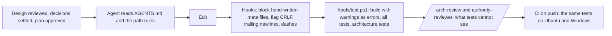

# Working with AI agents

Purpose: a short, practical guide to developing mp-poker with an AI coding agent: what the setup gives you, how the
automation catches mistakes, and how to add a feature without breaking the architecture. Details live in
[development](development.md) and [architecture](architecture.md). Back to [README](README.md).

## The idea in one minute

- **One set of rules for people and agents.** `AGENTS.md` at the repo root holds the instructions: layout, commands,
  architecture and authority rules, workflow, commit style. Every agent reads it; so should you.
- **Rules that matter are tests, not prose.** If an agent puts a feature reference where it does not belong, a
  test fails. The same applies to Unity code in shared code, a namespace that does not match its folder, or a stray
  dash.
- **The docs are the contract.** They describe the system as it is, and a change updates them in the same commit.
- **Scripts, not machine paths.** Everything runs through `./tools/*.ps1`, which find .NET and Unity on any machine.

## What is where

| Piece | What it does for you |
|---|---|
| `AGENTS.md` | The project brief every agent reads first (Codex, Cursor, Copilot, Gemini read it directly) |
| `CLAUDE.md` | Imports `AGENTS.md` for Claude Code and lists the Claude-only tools below |
| `.claude/rules/` | Style and layer rules per folder (C#, shared, server, client, tests, docs). Claude loads them automatically when it touches those paths; `AGENTS.md` points other agents to the same files |
| `.claude/skills/` | Slash commands that run a whole workflow (table below) |
| `.claude/agents/` | Two reviewers: `authority-reviewer` (cheating and fairness bugs) and `docs-sync` (stale docs) |
| `.claude/hooks/` | Guards that run on every edit and at session start (see "The safety net") |
| `tools/` | `setup`, `test`, `server`, `unity-tests`, `open-unity` scripts for PowerShell 5.1 or 7 |
| `tests/Poker.Tests/Architecture` | The architecture and hygiene tests |
| `.github/workflows/ci.yml` | Runs the tests on Ubuntu and Windows for every push and pull request |

### Skills (Claude Code)

| Command | Use it when |
|---|---|
| `/plan-feature <name>` | You have a feature design: reviews it against the rules and code, lists inconsistencies, asks you the important decisions, writes the review and the plan |
| `/new-slice <Name>` | Starting a new feature: creates the slice in shared, server and client, wires it into both composition roots |
| `/add-message <Slice> <Name> <kind>` | Adding a request, response or event end to end |
| `/test [filter]` | Building and running the .NET tests, with a short failure summary |
| `/unity-tests <EditMode or PlayMode>` | Running Unity tests headless (Editor closed) |
| `/run-local` | Starting the server and opening Unity, or running the end-to-end tests |
| `/arch-review` | Before committing: checks the change against the architecture, authority and style rules |
| `/update-docs` | After a change: brings the docs in line, in current-state wording |

## The safety net

Mistakes are caught as early as possible, and every later layer repeats the important checks:

- **Before coding**, a feature design is reviewed and planned with `/plan-feature`. While its plan is a draft or has
  open decisions, the feature gate hook asks you before any edit in the plan's scope, so important choices reach you
  instead of being guessed.
- **Before writing**, the agent knows the rules because they are in its context.
- **While writing**, hooks stop it from creating Unity `.meta` files by hand and point out text-format problems at
  once. A shell guard asks you when a Bash or PowerShell command looks like it would sneak around those checks.
- **When testing**, the architecture tests fail on a cross-feature reference or a misplaced namespace, with a message
  that names the file.
- **Before committing**, `/arch-review` checks layering inside a slice, the presentation queue, determinism (no wall
  clock or randomness in game logic) and hidden information. For server, shared and network code it runs the
  `authority-reviewer`.
- **On push**, CI runs the same `./tools/test.ps1`, so a non-Claude agent or a person without the hooks is held to the
  same rules.

## Adding a feature, step by step

Example: a table chat. You can type these prompts to Claude Code as they are; with another agent, ask for the same
steps and point it at [development](development.md).

1. **Design and plan.** Write `docs/features/table-chat/design.md` (or let `/plan-feature table-chat` start it from a
   template), then run `/plan-feature table-chat`. You get `review.md` with the inconsistencies and gaps (for example
   "chat history for a viewer who joins mid-hand is undefined") and multiple-choice questions for the decisions that
   are yours (own slice or part of `Table`? keep messages after a restart?). Your answers go into `plan.md` together
   with the steps, the exit tests and the commits. Approve it to lift the feature gate.
2. **Scaffold.** `/new-slice Chat`. You get the shared, server and client skeletons, wired into `MessageCatalog`,
   `ServerHost` and `RootLifetimeScope`. Focus the Unity Editor afterwards so it writes the `.meta` files.
3. **Messages first.** `/add-message Chat Send request`, then `/add-message Chat Posted event`. Each comes with its wire
   name, its registration, a server handler and a serialization test.
4. **Server logic.** "Implement chat on the server: posts go through the table actor, rate limit 1 per second." The
   agent writes a work item for the actor and tests it with `ManualClock`, so the test runs without waiting in real
   time.
5. **Client.** "Show chat in a popup with a toolbar button." The presenter subscribes to the event, the button goes
   through the kernel's `TableToolbar`, and the prefab comes from the editor builder. Edit Mode tests use the fake
   connection.
6. **Check.** `/test`, then `/unity-tests EditMode` (Editor closed), then `/run-local` to try it with the bots.
7. **Review and docs.** `/arch-review`, fix what it finds, then `/update-docs`.
8. **Commit.** One past-tense sentence, for example "Added table chat with a rate limit". The docs go in the same
   commit, and `docs/features/table-chat/` is deleted once the reference docs carry what it decided.

The order matters: shared, then server, then client logic, then views. Each layer is tested before the next one
depends on it.

## Keeping the architecture aligned

- **A feature never uses another feature's code.** It may read another slice's messages (they are the protocol) and
  react to its events (`ITableEventListener` on the server, bus events on the client).
- **A duplicate moves down**, into the kernel or infrastructure. Neither slice references the other.
- **The server decides, the client animates.** Chips move on screen only after the server's event; hidden cards are
  addressed to their owner only.
- **When an architecture test fails, fix the code, not the test.** If a rule really has to change, change the test,
  `AGENTS.md` and [architecture](architecture.md) together, in one reviewed commit.
- **Ask for a review whenever unsure:** "Run /arch-review on this branch" is cheap, and catches layering problems
  before they spread.

## Other agents and cloud sessions

- **Any agent.** `AGENTS.md`, the rule files it links, the docs and the scripts are plain files, so Codex, Cursor or
  Copilot follow the same workflow. They lack the skills and hooks, which is why CI and the architecture tests repeat
  the important checks.
- **Claude Code in the cloud.** The session-start hook installs the .NET SDK pinned by `global.json` and PowerShell, so
  `pwsh ./tools/test.ps1` works there. Unity is not available in the cloud: do server, shared and test work there, and
  Unity work locally.
- **Personal settings** go in `.claude/settings.local.json` and `CLAUDE.local.md`; both are ignored by git.

## When something goes wrong

| Symptom | Meaning and fix |
|---|---|
| A script exits with code 3 | The environment refused: a running server locks the DLLs (`./tools/server.ps1 -Stop`), or the Unity Editor has the project open (close it, or use its Test Runner window) |
| "Blocked: .meta files ..." | The agent tried to write a Unity `.meta` file. Let the Editor import the new files instead |
| An integration test times out | Integration tests run serially and should be stable, so treat it as a real failure; a new integration test class needs `[Collection(IntegrationCollection.Name)]` |
| Unity shows compile errors about `Poker.Shared` | The shared DLL is missing or stale: `./tools/setup.ps1` or `./tools/test.ps1` |
| "Feature ... the plan is not approved" prompt | A feature plan in scope is a draft or has open decisions. Answer them (`/plan-feature <name>`), or approve the single edit if you accept the risk |
| Docs and code disagree | Run `/update-docs` (or the `docs-sync` agent) and fix the doc in the same change |