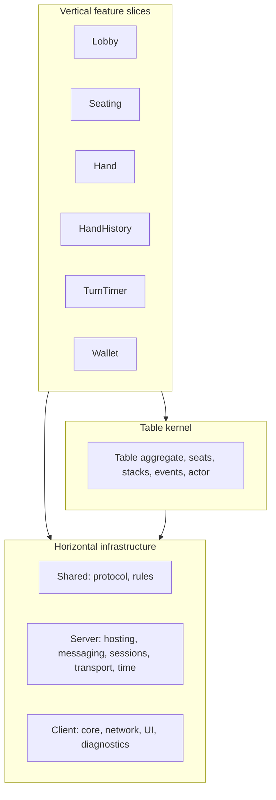

# Architecture

Purpose: the projects, how code is organized (horizontal infrastructure, vertical feature slices, a table kernel) and
the dependency rules for client, server and shared code. Back to [README](README.md).

## Organizing principle

- **Infrastructure is horizontal.** What every feature uses: transport, packets, sessions, reliability, message
  registry, serializers, message bus, views and popups, presentation queue, composition root.
- **Features are vertical slices.** One folder per feature on each side (and one assembly on the client) that cuts
  through every layer: its protocol messages, its server handlers and rules, its client domain, application,
  presenters and views. A feature is added, changed or removed in one place.
- **The table is a shared kernel.** Several features change the same table (seats, stacks, hand). The table aggregate
  lives in a small `Table` kernel slice; feature slices are use cases around it and react to each other only through
  events.



## Feature slices

| Slice | Shared (`shared/.../Features/X`) | Server (`server/.../Features/X`) | Client (`client/Assets/Features/X`) |
|---|---|---|---|
| `Table` (kernel) | `table.join`, `table.snapshot`, seat events, seat and table DTOs | `PokerTable`, `TableActor`, `TableDirectory`, `TableSeed`, `BotRoster`, `IChipBank` | `TableModel`, table screen, seats, `TableToolbar`, `HandText`, table events on the bus |
| `Lobby` | `lobby.*` | `ListTablesHandler` | `LobbyModel`, `LoadLobbyCommand`, lobby screen and presenter |
| `Seating` | `table.reserve_seat`, `table.buy_in`, `table.stand_up` | reserve, buy-in and stand-up work items | `SeatingFlow`, `BuyInPopup` |
| `Hand` | `hand.*`, `turn.*`, `round.*` | `PokerHand`, `HandEngine`, decks, `BotPolicy` | `HandModel`, `HandScene`, hand commands for the presentation queue, action panel, `PreAction` |
| `HandHistory` | `history.*`, `HandRecord` | `HandHistoryListener`, `HandHistoryBook` | `HandHistoryFlow`, `HandHistoryPopup` |
| `TurnTimer` | `player.sat_out`, `player.return`, `player.returned` | `TimeoutStrikeListener`, sit-out and return | `SitOutPresenter`, `AwayView` with the return button |
| `Wallet` | `wallet.*` | `WalletBook` (implements `IChipBank`), balance handlers | `WalletModel`, balance view, display lock |

Rules both sides need (hand evaluation, pots, cards) live in `shared/Poker.Shared/Rules`.

## Inside one slice (client example: `Lobby`)

```
client/Assets/Features/Lobby/
  Features.Lobby.asmdef        references: Infrastructure.*, Features.Table (kernel), Poker.Shared.dll
  Domain/        LobbyModel.cs           the slice's projection of server state
  Application/   LoadLobbyCommand.cs     use cases: requests out, events in
  Presentation/  LobbyPresenter.cs, LobbyScreen.cs
  Views/         ILobbyView.cs           view interfaces (views and prefabs are generated by editor builders)
  LobbyInstaller.cs            static Install(IContainerBuilder)
```

The same feature is `server/Poker.Server/Features/Lobby/` (handlers, work items, `LobbyFeature.Install`) and
`shared/Poker.Shared/Features/Lobby/` (`LobbyMessageNames`, `LobbyMessages.Register` at the root, messages in
`Requests/`, `Events/`, `Models/`). Client tests live in
`client/Assets/Tests/EditMode/<Slice>/`, server tests in `tests/Poker.Tests/Features/<Slice>/`.

## Projects and assemblies

| Project / assembly | Kind | Contains |
|---|---|---|
| `Poker.Shared` | netstandard2.1 | `Infrastructure/Protocol` (`Packets`, `Messages`, `Reliability`, `SystemMessages`), `Rules/` (`Cards`, `Hands`, `Pots`), `Features/*` (messages per slice), `MessageCatalog` |
| `Poker.Server` | net8.0, one assembly | `Infrastructure/` (Hosting, Messaging, Session, Time, Transport), `Features/*` |
| `Poker.Tests` | net8.0 | Tests per slice, infrastructure, shared, integration, architecture |
| Unity `Infrastructure.Core` | asmdef | App state machine; `Commands/` pipeline, `Messaging/` bus, `Presentation/` queue and display lock |
| Unity `Infrastructure.Network` | asmdef | `Connection/` (`IServerConnection`, socket adapter), `Requests/` (request map, errors), `Messaging/` (router, serializer), `Reliability/`, `Session/`, `Clock/`, `DevTools/` (link conditioner, stats, transcript) |
| Unity `Infrastructure.UI` | asmdef | `Views/` (loading, pooling, layers), `Popups/`, `Motion/`, `Flights/`, `Layout/` (safe area) |
| Unity `Infrastructure.Diagnostics` | asmdef | `DevPanel/` (panel, actions, render stats), `Reports/` (log ring buffer, bug report) |
| Unity `Features.<Name>` | asmdef per slice | Domain, Application, Presentation, Views of one feature |
| Unity `App.Root` | asmdef | Composition root (`RootLifetimeScope` in `Main.unity`), `Startup/` commands, `Connection/` supervision; references all features |
| Unity `App.Editor` | asmdef, editor only | `Builders/` (scene, prefabs, skin, atlases, fonts), `Import/` settings, `Build/` (Android, Addressables report), `UiSnapshot` |

`Poker.Shared.dll` is built by the .NET solution and copied into `client/Assets/Plugins/Poker.Shared/`; Unity uses it
as a precompiled reference.

## Files and folders

At most 8 `.cs` files per folder (`FolderSizeTests`); past about 6, files are grouped by responsibility into
subfolders, and the namespace follows the folder. Module entry points (installers, `<Slice>Messages`) stay at the module
root. The rules for naming those folders are in `.claude/rules/csharp-style.md`.

## Layers inside every client slice

| Layer | Responsibility | Must not |
|---|---|---|
| View (MonoBehaviour) | Render, raise UI input | Hold logic, talk to the network, be injected |
| Presenter | Bind one view to application state; translate input into intents | Mutate domain state directly |
| Application | Use cases of the slice; handle its network events; publish bus events | Touch Unity UI types |
| Domain | The slice's projection of server state; invariants | Know about network or UI |

Dependency direction inside a slice: View <- Presenter -> Application -> Domain; Application -> infrastructure.

## Dependency rules

Enforced by the architecture tests in `tests/Poker.Tests/Architecture` (server namespaces, shared code, client asmdefs)
and on the client also by asmdef references:

1. A feature may use infrastructure, the `Table` kernel and `Poker.Shared`; **never another feature's
   implementation**. Shared message contracts are the protocol, so a feature may read another slice's messages (the
   history listener reads `Hand` events), but never its server or client code.
2. Features react to each other only through events: bus events on the client, table events and
   `ITableEventListener` in the actor on the server.
3. Infrastructure never references features.
4. `Poker.Shared` references nothing outside the BCL subset Unity supports; no `UnityEngine`.
5. Rules both sides need live in `shared/`; server-only decisions (shuffle, deadlines) live in `server/Features/X`.
6. Only the composition roots know all features: `ServerHost` on the server; `App.Root` (plus `App.Editor` and the
   test assemblies) on the client.

## When a new piece of code arrives

| It is... | Put it in |
|---|---|
| Used by one feature only | That feature's slice |
| Used by two features and is game state | The `Table` kernel |
| Used by two features and is technical | Infrastructure |
| A duplicate of something in another slice | Move it down to the kernel or infrastructure; do not reference the other slice |

[development](development.md) has the step-by-step recipe for a new slice or message.

## Cross-cutting

| Concern | Approach |
|---|---|
| Time | `IClock` on the server, `IServerClock` on the client; tests use `ManualClock` and `FakeServerClock` |
| Randomness | `IDeckFactory` on the server; tests use a seeded or scripted deck |
| Logging | Server: `Microsoft.Extensions.Logging`. Client: Unity log, captured by `LogRingBuffer` for bug reports |
| Errors | Rejected requests carry error codes; the client turns them into `RequestRejectedException` |
| Config | Server options classes and `ConnectionOptions`; the client gets timing in `sys.welcome` |