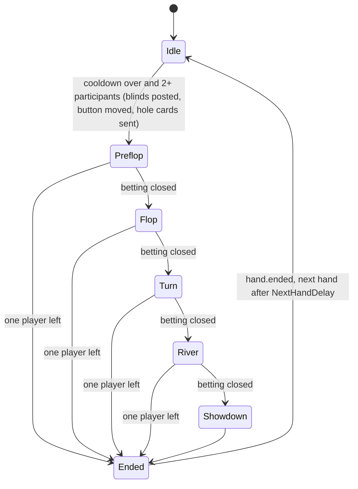

# Game authority

Purpose: what the server owns, what the client owns, the hand lifecycle on the server, turn identity, timers, hidden
information, randomness, bots and chip rules. Back to [README](README.md).

## Authority table

| Area | Owner | Client role |
|---|---|---|
| Deck, shuffle, hole cards, board | Server | Render what it receives |
| Seats, reservations, buy-in limits | Server | Send intents |
| Turn order, allowed actions, call and raise limits | Server (`turn.started`) | Show only the allowed buttons |
| Bet validation and application | Server | Never move chips before `turn.acted` |
| Pots, side pots, payouts | Server | Animate the result |
| Turn deadline | Server | Show a shorter timer in server time |
| Sit-out after timeouts | Server | Show "away", send `player.return` |
| Hand ranking for display (best five highlighted) | Client, using the shared `HandEvaluator` | Cosmetic only |
| Presentation timing | Client | Presentation queue |
| Navigation (lobby, table, popups) | Client | App state and screens |
| Pre-actions (check/fold, call any) | Client (`PreAction`) | Sent as an ordinary `turn.act` when its turn starts |

The client is a view with an input box. A modified client can only delay or skip its own intents.

## Hand lifecycle (server)

`HandEngine` (`server/.../Features/Hand/Runtime`) runs inside the table actor on every tick and table change:

`PokerHand` (`Domain`) holds one hand: streets (`Street`), betting, pots (shared `PotCalculator`), showdown (shared
`HandEvaluator`). A betting round is: next actor, `turn.started`, wait for `turn.act` or the deadline, apply,
`turn.acted`, check closure (all matched or all-in), then `round.ended`. When everyone left is all-in, the remaining
board is dealt without betting.

## Turn identity and idempotency

- Each turn gets `turnId = handNumber * 1000 + sequence within the hand` (`PokerHand.TurnId`).
- `turn.act` must carry the current `turnId`; a different id is rejected with `turn.stale`.
- A resent or duplicated intent (resume, double tap) is therefore applied at most once.
- After the deadline the server applies the timeout action (check if free, else fold) and broadcasts
  `turn.acted {reason: timeout}`; a late intent gets `turn.stale`.

## Timers

| Value | Where | Default |
|---|---|---|
| Turn time (what the player sees) | `HandOptions.TurnTime` | 15 s |
| Leeway | `HandOptions.TurnLeeway`, sent as `leewayMs` | 2 s |
| Server turn deadline | sent as `deadlineUnixMs` | turn time plus leeway, 17 s |
| Client visible timer | client | ends at `deadlineUnixMs - leewayMs` in server time (`ServerClock`); input closes there |
| Timeouts before sit-out | `TurnTimerOptions.StrikesToSitOut` | 2 consecutive |
| Reservation window | `TableSeed` | 20 s |
| Cooldown between hands | `HandOptions.NextHandDelay`, sent as `nextHandInMs` | 3 s |
| Bot think time | `HandOptions.BotThinkMin` / `BotThinkMax` | 0.6 to 1.5 s |

The visible timer ends before the server deadline so a last-moment click still arrives in time. Animations eat into the
visible time; [sync flows](sync-flows.md) show the first-move case. The actor ticks every 250 ms
(`TableHostService`), and all logic reads the injected `IClock`.

## Hidden information

- A `TableEvent` is public, or addressed to one player (`RecipientPlayerId`). The actor sends an addressed event only
  to that player's connections.
- `hand.hole_cards` is addressed to its owner; `hand.snapshot` carries only the receiver's own cards in `myCards`.
- Showdown reveals only the cards of players still in the hand at showdown.
- The hand history read model keeps other players' cards hidden unless they were shown.
- A test asserts that no packet to seat A contains seat B's hole cards before showdown.

## Randomness

- `SecureDeckFactory`: Fisher-Yates with `RandomNumberGenerator.GetInt32`.
- The client never shuffles and never receives the deck.
- Tests inject `IDeckFactory`: `SeededDeckFactory` for repeatable games, `ScriptedDeck` for exact scenarios (split
  pots, all-in side pots).

## Bots

Bots are server-side players that act through the same validation as humans. `TableSeed` seats them at startup (the
practice table has three, the heads-up table one; ids start with `bot-`, recognised by the kernel's `BotRoster`), and
the house tops up their stacks. `BotPolicy` (`Hand/Bots`) picks a legal action from `turn.started` with simple odds,
after a random think time; both use a `Random` seeded by `HandOptions.BotSeed` when set, so tests replay bots exactly. Bots make the table playable alone.

## Chip rules

1. Chips are `long` whole units; never floating point.
2. Within a hand, sum(stacks) + sum(pots) is constant (an invariant checked in tests).
3. Chips move only between a wallet and a seat. Buy-in withdraws from the wallet (refused with
   `buyin.insufficient_funds`); releasing a seat deposits its stack. The kernel defines `IChipBank`; the Wallet slice
   implements it (`WalletBook`).
4. A seat in a running hand is never released early: standing up or an expired session marks it leaving, the hand
   folds the player, and the hand's end writes the final stack and releases the seat, which pays out exactly that. So
   sum(wallets) + sum(stacks) + sum(pots) changes only by free chips and the house chips that top up bots.
5. The client shows balances from server events only; the displayed wallet balance is held (`DisplayLock`) until the
   animation that explains a change has played.

## Extension ideas

- Provably fair: log a hash of the deck order at hand start and reveal the order after the hand.
- Pluggable bot strategies (tight-passive, calling station) behind an interface.
- Muck or show choice at showdown.