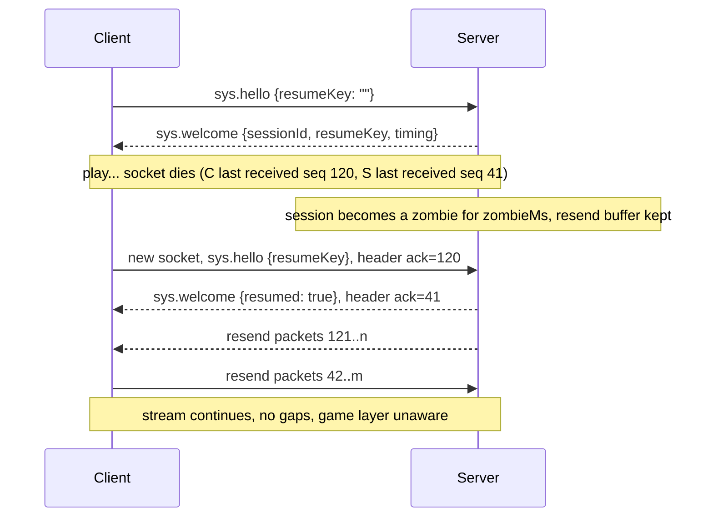

# Reliability and resume

Purpose: the reliability layer above the WebSocket: ordering, acks, resend, heartbeat, session resume and full
reconnect. Back to [README](README.md).

## Why TCP is not enough

TCP guarantees order and delivery only inside one connection. On mobile the connection dies silently (tunnel, Wi-Fi
to LTE switch, app in background), and bytes the OS accepted but never delivered die with it. Without its own layer, a
"call 200" or a "you won the pot" event can vanish. The fix is an application-level sequence that survives socket
replacement.

Loss model: one WebSocket never loses or reorders bytes, so loss only exists when a socket dies with packets in flight.
The client's link conditioner reproduces exactly that ([testing](testing.md)).

## Mechanics

One shared class, `ReliableChannel` (`Poker.Shared`), does numbering, ack trimming, duplicate and gap detection and
the resend list for both sides.

| Mechanism | Rule |
|---|---|
| Numbering | Each side numbers its reliable packets `seq = 1, 2, ...` (u16, wrapping); `sys.*` packets stay unnumbered |
| Ordering check | The receiver requires `seq == lastReceived + 1`; a gap is fatal (`4006 SequenceGap`), since it cannot happen on one healthy socket |
| Duplicate | `seq <= lastReceived` (with wrap math) is dropped silently: a resend the receiver already has |
| Piggy-backed ack | Every outgoing packet carries `ack = lastReceived` |
| Standalone ack | If `maxUnacked` packets arrived and nothing is going out, send `sys.ack` |
| Resend buffer | The sender keeps sent packets until acked. The capacity must stay below half the sequence space so wrap-around comparisons hold; the constructor refuses more. Overflow aborts the socket and ends the session |
| Heartbeat | `sys.ping` every `heartbeatMs`; no traffic for `2 x heartbeatMs` means the socket is dead |
| Clock | `sys.pong` returns server time; `ServerClock` keeps the offset from the lowest round trip of its recent samples |

## Session resume

Rules:
- The server keeps a disconnected session (zombie) for `zombieMs`. Table logic keeps running: the turn timer does not
  pause.
- On resume both sides resend everything after the peer's `ack`.
- A resume key is single-use; a successful resume issues a new key.
- Requests survive a resume: a numbered request is resent and answered on the new socket. Only unnumbered requests
  (hello, ping) fail when their socket dies; a new session fails every pending request except the hello that started
  it.

## Full reconnect

When resume is impossible (unknown or expired key, resend overflow, app restart), the server answers
`resumed: false` with a new session:
1. The client publishes `SessionRestarted`.
2. The table rejoins (`table.join`) for a fresh `table.snapshot`, the hand view clears, and a pending buy-in is
   abandoned. After an app restart, `seatedTableId` in the welcome names the table to reopen.
3. Missed animations are not replayed; the UI jumps to the snapshot.

## Client connection handling

The app state (`AppState`: `Booting`, `Connecting`, `Connected`, `Disconnected`, `Failed`) plus
`ConnectionSupervisor` (`App`) form the connection state machine:
- On socket loss the supervisor retries connect and hello with backoff (0.5 s doubling to 8 s, plus 0 to 250 ms
  jitter), sending the resume key.
- `resumed: true` resends the client's unacked packets; the game layer never notices.
- `resumed: false` runs the full reconnect above.
- After `4007 DuplicateLogin` the client stops and offers "Play here", which reloads the app (`AppReloader`) and takes
  the session back.

## Parameters

| Parameter | Value | Where | Reason |
|---|---|---|---|
| `heartbeatMs` | 10,000 | `ConnectionOptions.HeartbeatInterval` | Detect dead sockets within about 20 s |
| `zombieMs` | 30,000 | `ConnectionOptions.ZombieWindow` | Cover short drops, free the session soon after |
| `maxUnacked` | 30 | `ConnectionOptions.MaxUnacked` | Bounded resend buffer without ack chatter |
| Resend capacity | 4,096 packets | `ConnectionOptions.ResendCapacity` | Far above one hand's traffic |
| Reconnect backoff | 0.5 s doubling to 8 s, plus 0 to 250 ms jitter | `ConnectionSupervisor` | Avoid a thundering herd after a server restart |

The server sends `heartbeatMs`, `zombieMs` and `maxUnacked` in `sys.welcome`, so they can be tuned without a client
release.

## Extension ideas

- Endpoint failover: a list of endpoints, remembering the last one that worked, and a visible "cannot connect" state.
- Measure resume success rate under the bot load test.