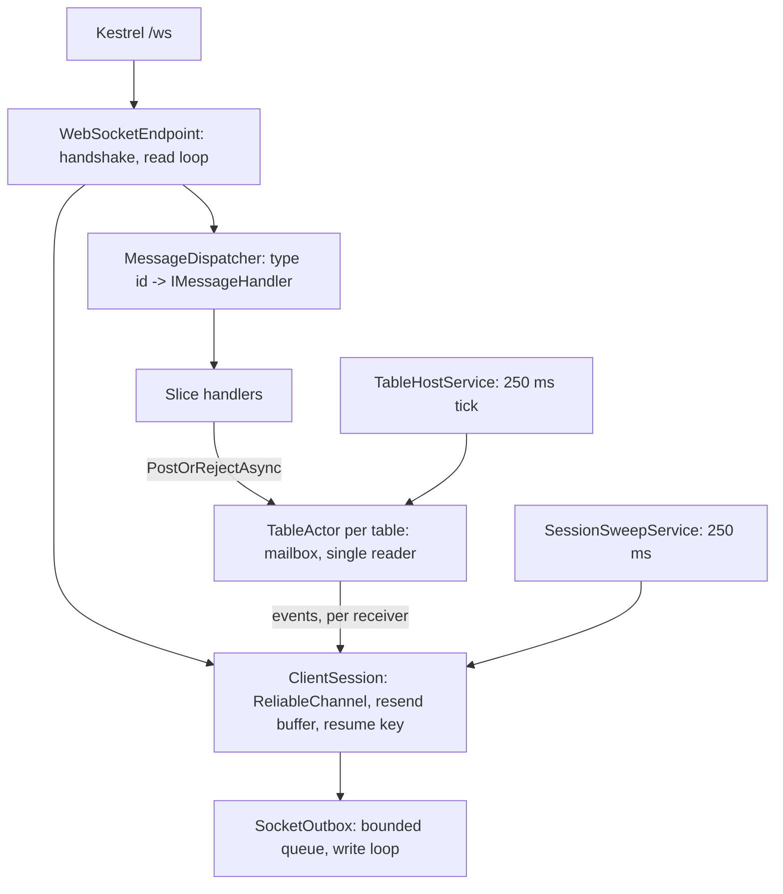

# Server design (.NET 8)

Purpose: the server internals: host, sessions, dispatch, table actors, slices and their extension points, the read
model, configuration and logging. Back to [README](README.md).

## Process layout



`ServerHost.Build` (`Infrastructure/Hosting`) is the composition root: it registers the infrastructure and calls every
slice's `<Slice>Feature.Install(IServiceCollection)`. It is the only code that knows all features.

## Infrastructure

| Area | Types | Job |
|---|---|---|
| Hosting | `ServerHost`, `WebSocketEndpoint` | Composition root; accept `/ws`; handshake (new session or resume); per packet: seq check (a gap closes with `4006`, a duplicate is dropped, an unnumbered game message is dropped), dispatch, standalone `sys.ack` after `maxUnacked` |
| Transport | `IClientConnection`, `IConnectionListener`, `OutgoingMessage`, `PlayerIdentity` | What tables and handlers see of a connection. `OutgoingMessage` is a broadcast event serialized once; each session copies the bytes and writes its own seq and ack |
| Session | `ClientSession`, `SocketOutbox`, `SessionManager`, `SessionSweepService`, `HelloValidator`, `PingHandler`, `ConnectionOptions` | `ClientSession` is the `IClientConnection` tables hold: it owns a `ReliableChannel` and the current socket's `SocketOutbox` (none while a zombie). Sending numbers and buffers every game message even without a socket, and never waits on the socket, so a table actor never waits for a slow client. A full outbox aborts the socket and the client resumes from the resend buffer |
| Messaging | `MessageDispatcher`, `IMessageHandler`, `MessageHandler<T>`, `MessageContext`, `JsonPayloadSerializer` | Decode, find the handler for the CLR type, run it; respond or reject through the context |
| Time | `IClock`, `SystemClock` | The only source of "now"; tests use `ManualClock` |

The areas are layered bottom up: Time, Transport, Messaging, Session, Hosting. An area uses only the areas below it
(enforced by `ServerDependencyTests`).

Session rules:
- `SessionManager` keeps sessions by resume key; a resume rotates the key; `TakeExpired` returns zombies past the
  window.
- A graceful close (the client sends a close frame) ends the session at once; only a lost socket leaves a zombie.
- A socket silent for two heartbeats is aborted, and its session becomes a zombie.
- `SessionSweepService` ends expired zombies every 250 ms and calls the `IConnectionListener`s, so tables release the
  player's seat (`table.seat_released {reason: disconnected}`).
- A new session for a player who already has one closes the old socket with `4007` and takes over the player.

## Table actor

Each table is a `TableActor` (`Features/Table/Runtime`) with an unbounded `Channel<ITableWork>` mailbox and a single
reader. A slice's handler wraps its request in a work item and posts it with `TableDirectory.PostOrRejectAsync`; the
actor runs one item at a time, then sends the events the `PokerTable` aggregate recorded to every watcher (dropping
watchers whose socket is gone). Adding a slice never changes the actor.

```csharp
public interface ITableWork
{
    Task ExecuteAsync(TableContext context, CancellationToken cancellationToken);
}
```

- Game state changes only inside the actor, never on a handler thread.
- Time comes from `TableContext.Now` (the injected `IClock`); `TableHostService` posts every registered
  `ITableTickWork` to every actor every 250 ms, which drives deadlines, bot actions, reservation expiry and hand starts.
- Snapshots for joiners are cut between two work items, so snapshot plus the following events is exact.

## Feature slices on the server

| Slice | Work items | Owns |
|---|---|---|
| `Table` (kernel) | `JoinTableWork`, `DisconnectWork`, `ExpireReservationsWork` | `PokerTable` aggregate (seats, stacks, reservations, recorded events), `TableDirectory`, `TableActor`, `TableSeed`, `BotRoster`, `IChipBank` |
| `Lobby` | none (`ListTablesHandler` reads the directory) | Table summaries |
| `Seating` | `ReserveSeatWork`, `BuyInWork`, `StandUpWork` | Handlers and responses; the seat rules live in the kernel aggregate |
| `Hand` | `TurnActWork`, `HandTickWork` | `PokerHand` (betting, pots, showdown), `HandEngine`, decks (`IDeckFactory`), `BotPolicy`, `HandOptions` |
| `TurnTimer` | `PlayerReturnWork`; `TimeoutStrikeListener` | Consecutive-timeout count per seat, sit-out and return. The deadline and the check-or-fold timeout stay in `Hand`, which also skips sitting-out seats when dealing |
| `HandHistory` | none; `HandHistoryListener` | Read model of finished hands (below) |
| `Wallet` | none; `GetBalanceHandler`, `AddChipsHandler` answer outside the actors | `WalletBook` (balances, free-chips rule) implementing the kernel's `IChipBank`; pushes `wallet.balance_changed` to the owner |

Kernel extension points, so slices plug in without the kernel knowing them:

| Extension point | Used for |
|---|---|
| `TableContext.GetState<T>()` | Per-table slice state (`HandTableState`, `TurnTimerTableState`, `HandHistoryDraft`) |
| `ITableTickWork` | Periodic work registered in DI (`HandTickWork`, `ExpireReservationsWork`) |
| `ISnapshotContributor` | Sending `hand.snapshot` right after `table.snapshot` |
| `TableEvent(message, recipientPlayerId)` | Addressed events such as hole cards |
| `EnterHand` / `LeaveHand` on the kernel | While a hand holds a seat, a release only marks it leaving; `LeaveHand` releases it after the final stack is written |
| `IChipBank` | Buy-in withdraws, seat release deposits the stack |
| `ITableEventListener` | Reacting to another slice's events without referencing it: the actor calls every listener for every event before sending; a reaction is inserted right after its cause, and a failing listener is logged and skipped |

Slices never call each other. For example `TurnTimer` counts timeouts from `Hand`'s `turn.acted` through its
listener. Everything runs on the actor's thread, so ordering is deterministic and tests assert exact event sequences.

## Read model: hand history

`HandHistoryListener` builds a draft of the running hand in per-table state (`HandHistoryDraft`): names and starting
stacks at `hand.started`, hole cards from the addressed `hand.hole_cards` events, actions per street, the board and the
showdown reveals. At `hand.ended` it writes one `HandRecord` per human player into `HandHistoryBook` (the last 20 per
player, in memory, behind a lock because every table writes to it), each from that player's point of view, so hidden
cards never leak into another player's record. `GetHandHistoryHandler` reads the book. The table is the write model,
the book a read model built from the same event stream; it can be dropped and rebuilt without touching table logic.

## Configuration

- `appsettings.json`: the listen URL (`http://localhost:5080`) and log levels. `--urls` overrides the URL
  (`tools/server.ps1 -Port`).
- Section `Connection` binds `ConnectionOptions` (heartbeat, zombie window, max unacked, resend capacity), for example
  `--Connection:ZombieWindow=00:00:01` in tests.
- `HandOptions`, `TurnTimerOptions` and `WalletOptions` are registered with their defaults by each slice's installer;
  the tables come from `TableSeed`.

## Logging

`Microsoft.Extensions.Logging` to the console: connection lifecycle, dropped packets, failing listeners and work
items. The client's dev panel carries the detailed network view ([client](client.md)).

## Persistence

None: tables, seats, wallets, sessions and history are in memory and reset on restart.

## Extension ideas

- Persist stacks and wallets (an `IStackStore` called at hand end, SQLite behind it).
- Bind `HandOptions` and table presets from configuration.
- Split sessions and tables into separate processes: the mailbox becomes a network hop, and the header's `channel`
  multiplexes tables, so the client does not change.
- Metrics: sessions, zombies, resumes, packets per second, mailbox depth, hand duration.