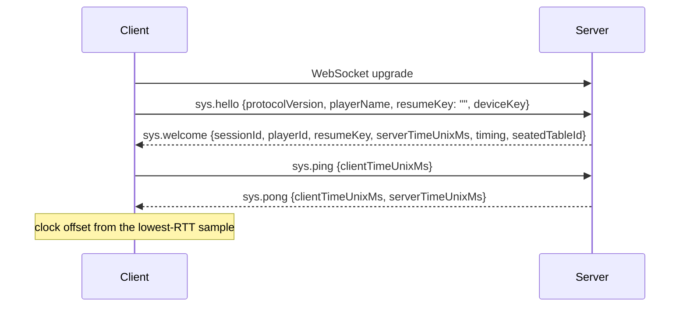
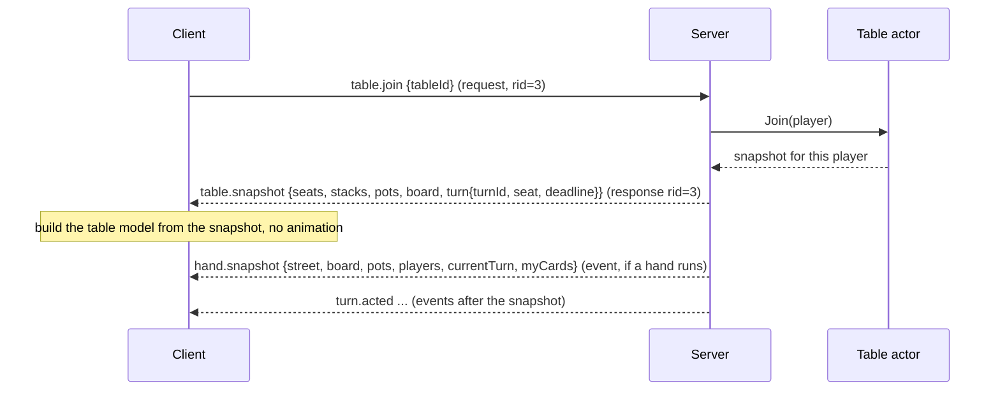
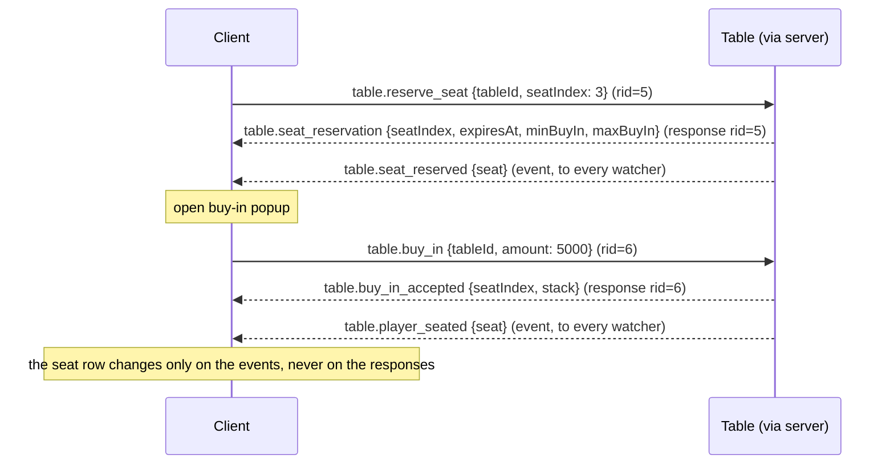
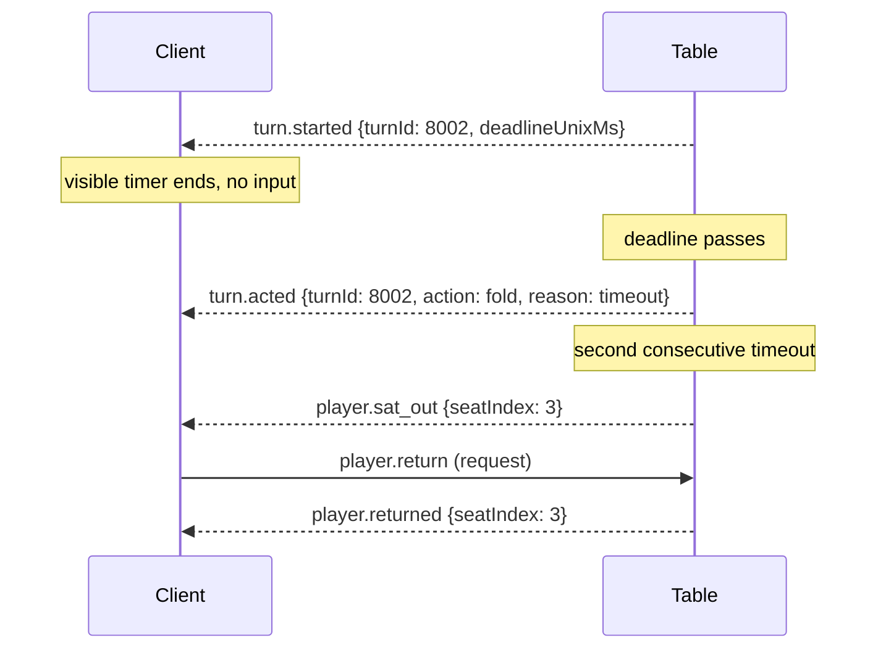

# Sync flows

Purpose: every important flow as a sequence diagram, so the protocol, authority and presentation rules can be checked
against concrete situations. Back to [README](README.md).

## 1. Connect and log in



The startup commands (`ConnectCommand`, `HelloCommand`, then `SyncClockCommand` beside the lobby load) complete on
these answers. If `seatedTableId` is not empty, `ReturnToTableCommand` opens that table right after the lobby loads
(recovery after an app restart).

## 2. Join a table mid-hand (snapshot)



The snapshot is cut inside the actor between two events, so "snapshot then stream" has no gap and no overlap. Slices
that own extra table state add it through `ISnapshotContributor` (the Hand slice sends `hand.snapshot`).

## 3. Sit and buy in (reserve, then pay)



If the popup stays open past `expiresAt`, the server's tick releases the seat (`table.seat_released {reason:
reservationExpired}`), which also closes the popup. Cancel sends `table.stand_up` to release the seat at once. A
session that ends (its zombie window passed) releases a reserved seat with reason `disconnected`.

## 4. One hand (server to clients)

Each hand event becomes one `HandStepCommand` in the `PresentationQueue` (`client/.../Features/Hand/Presentation/Commands`):

```
hand.started       -> HandStartedCommand    (blinds shown, cards dealt to every player)
hand.hole_cards    -> HoleCardsCommand      (my two cards face up)
turn.started       -> TurnStartedCommand    (waits behind the deal; starts the visible timer)
turn.acted         -> PlayerActedCommand    (the bet flies in)
round.ended        -> RoundEndedCommand     (bets collected to the pot)
round.started      -> RoundStartedCommand   (each board card flies from the deck)
hand.showdown      -> ShowdownCommand       (reveals, best five highlighted)
hand.ended         -> HandEndedCommand      (pot to the winners, then the wallet display is released)
hand.snapshot      -> HandSnapshotCommand   (mid-hand join: end state, no animation)
```

The server sends related events in the same instant (hand started plus first turn started). The client plays them at
animation speed; durations live in `HandTimings`.

## 5. My turn and my action

```mermaid
sequenceDiagram
  participant P as Player
  participant C as Client
  participant T as Table
  T-->>C: turn.started {turnId: 7004, seatIndex: 3, deadlineUnixMs, toCall: 200}
  Note over C: TurnStartedCommand runs when the queue reaches it; visible timer = deadline - leeway
  P->>C: tap Call
  C->>T: turn.act {turnId: 7004, action: call} (request)
  T-->>C: turn.act_accepted {turnId: 7004} (response)
  Note over C: buttons hidden, nothing else changes
  T-->>C: turn.acted {turnId: 7004, seatIndex: 3, action: call, amount: 200, stack: 4800} (to everyone)
  Note over C: chips animate now, for every client identically
```

Pre-action: if "check/fold" or "call any" was chosen (`PreAction`), the client sends `turn.act` as soon as
`turn.started` for its seat is processed, without showing the buttons.

## 6. Timeout, sit-out, return



## 7. Request with a side effect on another stream

```mermaid
sequenceDiagram
  participant C as Client
  participant S as Server
  C->>S: wallet.add_chips {} (request, rid=9)
  S-->>C: wallet.balance_changed {balance, delta, reason: freeChips} (event)
  S-->>C: wallet.balance {balance} (response rid=9)
  Note over C: request map resolves rid=9; balance already applied from the event
```

Lesson: the client must not assume the response arrives before related events. Both are ordered by one sequence, but
their relative order is the server's choice.

## 8. Drop shorter than the zombie window

Socket lost at second 0, back at second 6. Resume with `resumeKey`; both sides resend after the peer's ack; the client
plays the missed events. If the visible timer expired meanwhile, the server already applied the timeout; the client
shows it from the stream. Details in [reliability](reliability.md).

## 9. Drop longer than the zombie window

Socket lost for 45 s. The session expired, so the next hello gets `sys.welcome {resumed: false}` with a new session.
The client publishes `SessionRestarted`: the table rejoins and receives a fresh `table.snapshot` (plus
`hand.snapshot` mid-hand), the hand view clears, and a pending buy-in is abandoned. The presentation queue is cleared;
each queued command's `Finish()` applies its end state without animation. The player may come back "sat out".

## 10. Same player on a second device

A second app signs in with the same `deviceKey`. The server closes the first socket with `4007 DuplicateLogin` and
the new session takes over the player and the seat. The first app shows "Signed in on another device." with a "Play
here" offer, which reloads the app (`AppReloader`) and takes the player back the same way.

## 11. Server restart

All state is in memory: tables, seats, wallets and sessions start fresh. Clients reconnect with backoff, get
`resumed: false` and an empty `seatedTableId`, and land in the lobby.